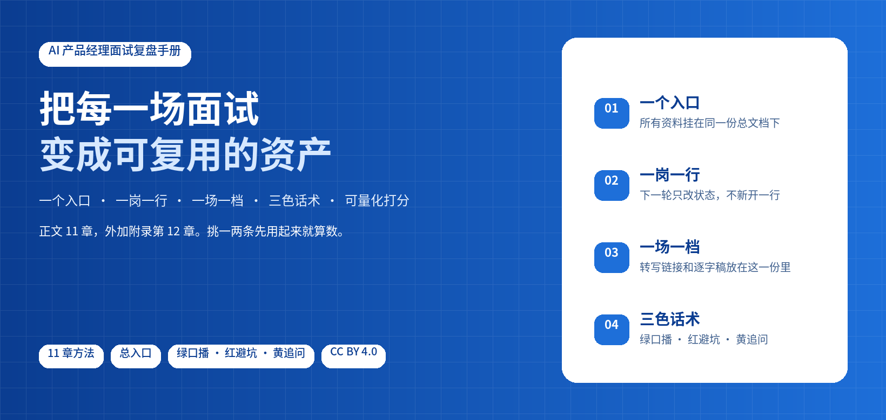

# AI 产品经理面试复盘手册

把每一场面试变成可复用的资产。

[](#目录)
[](#建飞书结构)
[](#一场面试从投递到复盘)
[](#三色框)
[](#许可)

<table>
<tr><td align="right"><b>下载</b></td><td align="left">

<a href="https://github.com/CageEcho/howtointerviewbetter/archive/refs/heads/main.zip">仓库 ZIP</a>

</td></tr>
<tr><td align="right"><b>查阅</b></td><td align="left">

<a href="#这套东西是什么">这套东西是什么</a> · <a href="#适合谁">适合谁</a> · <a href="#快速开始">快速开始</a> · <a href="#目录">目录</a> · <a href="book/">正文</a> · <a href="templates/">模板</a> · <a href="examples/示例-某软件公司二面复盘.md">脱敏样例</a>

</td></tr>
<tr><td align="right"><b>照着做</b></td><td align="left">

<a href="skills/interview-review/README.md">让 AI 照书做复盘（skill）</a> · <a href="skills/interview-review/feishu-setup.md">一键建飞书结构</a> · <a href="#一场面试从投递到复盘">从投递到复盘</a> · <a href="#每周节奏">每周节奏</a> · <a href="templates/复盘文档模板.md">复盘模板</a> · <a href="templates/打分表.md">打分表</a>

</td></tr>
</table>


## 这套东西是什么

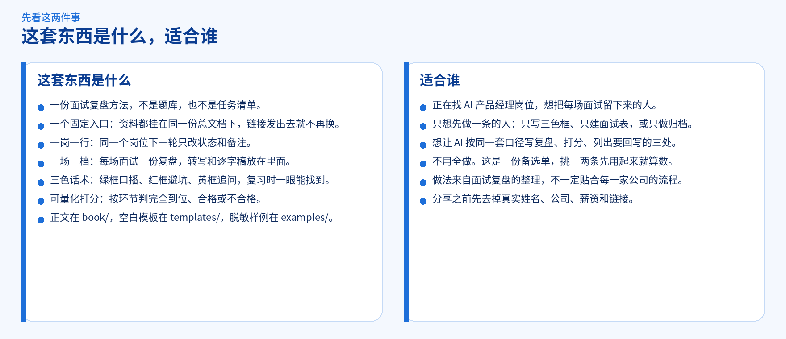

这是一份面试复盘方法：一个固定入口、一岗一行、一场一档、三色话术、可量化打分。正文在 [book/](book/)，空白模板在 [templates/](templates/)，脱敏样例在 [examples/](examples/)。想让 AI 照着做，用 [skills/interview-review/](skills/interview-review/)。

它不是题库。题库会过期，口径不会。你留下的是同一套问法：这场原话是什么、问题出在哪、下次 60 秒里怎么说、哪个概念不能再混、对方可能怎么追问。下一场打开就能用。

四份东西各管一件事：

| 你打开的 | 它回答 |
| --- | --- |
| [book/](book/) | 为什么这样记，反例是什么 |
| [templates/](templates/) | 空白的复盘、打分表、面试表字段 |
| [examples/](examples/) | 脱敏之后长什么样 |
| [skills/interview-review/](skills/interview-review/) | 让助手按上面三份来写，不自己发明格式 |

做法来自面试复盘的整理，不一定贴合每一家公司的流程。分享之前先去掉真实姓名、公司、薪资和链接。发现写错了，欢迎[提 issue](https://github.com/CageEcho/howtointerviewbetter/issues)。

## 适合谁

- 正在找 AI 产品经理岗位，希望每场面试都留下能复习的原话、打分和口播。
- 只想先做一条的人。三色框、一岗一行、一场一档，单独做哪一条都成立。
- 想把转写交给助手，让它按同一套口径写完，并列出要回写的三处。
- 不用飞书、不用某一种转写工具，也可以。方法在 [第 11 章](book/11-隐私权限与复制.md)。

不用全做：这是一份备选单，不是任务清单——挑一两条先用起来就算数。


## 快速开始


```bash
git clone https://github.com/CageEcho/howtointerviewbetter.git
cd howtointerviewbetter
```

不想装 Git，就用上面的 [仓库 ZIP](https://github.com/CageEcho/howtointerviewbetter/archive/refs/heads/main.zip)，解压后进入该目录。

挑一条就能开始，其余以后再补：

- 只写三色框：把下一场要念的口播写进绿框。
- 只建面试表：一个岗位一行，下一轮只改状态。
- 只做归档：每场面试一份文档，放上转写链接和逐字稿。


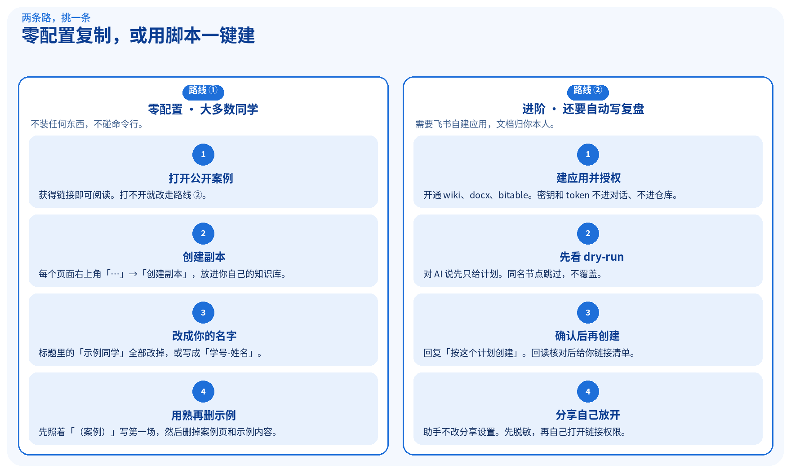

### 路线 ① 零配置：手动复制模板（推荐，大多数同学选这个）

> [!TIP]
> 不装任何东西、不碰命令行，就能拿到一整套带攻略和示例的飞书结构：

[](https://my.feishu.cn/wiki/KTmswsbhOi3deQk8wUdcDWYcnrf)

1. **打开公开案例**：[**（案例）示例同学-个人面试记录表&复盘**](https://my.feishu.cn/wiki/KTmswsbhOi3deQk8wUdcDWYcnrf)（获得链接即可阅读）。
2. 在每个页面右上角<strong>「…」→「创建副本」</strong>，位置选**你自己的知识库**（总入口建议最先复制，子页面复制到它下面）。多维表格「面试表」同样「创建副本」。
3. 把标题里的<strong>「示例同学」全部改成你的名字</strong>（或「学号-姓名」）。
4. 先照着「（案例）」页面写第一场复盘，用熟后**把带「（案例）」「（示例）」的页面和内容删掉**。

做的时候按这个顺序，不容易把副本建散：

1. 先复制总入口，确认它落在你自己的知识库里。这一份就是以后对外发的那个链接，发出去就不再换。规则见 [第 1 章](book/01-总入口与目录结构.md)。
2. 再复制子页面，父级选刚刚那份总入口。面试表是多维表格，同样走「创建副本」，不要只是收藏原表。
3. 标题改完再写内容。没改完就往里填，之后分不清哪些是示例、哪些是你的。
4. 第一场对照「（案例）」和 [第 12 章](book/12-各板块建设攻略与示例.md) 看每一页该写什么。格式熟了，把案例页和带「（示例）」的块删掉。案例可以留着当参照，不想留再删。

> [!IMPORTANT]
> 这个链接能打开，前提是仓库作者把案例设成了「互联网上获得链接的人可阅读」。打不开时请在 issue 里告诉作者，或改用路线 ②。

### 路线 ② 进阶：用脚本一键建（需要飞书自建应用）

适合想让 AI 助手直接往你飞书里建、后续还要自动写复盘的同学。准备工作（建应用、开权限、找 space_id、常见报错）见 [feishu-app-setup.md](skills/interview-review/feishu-app-setup.md)。

这条路的完整七步在下面[「建飞书结构」](#建飞书结构)。和路线 ① 的差别是：文档由脚本在你自己的账号下创建，每页已经写好说明框、建设攻略和（示例）内容；分享权限仍然要你自己开。助手先给 dry-run 计划，你确认之后才创建。


## 安装 Skill

<a href="skills/interview-review/README.md"></a>


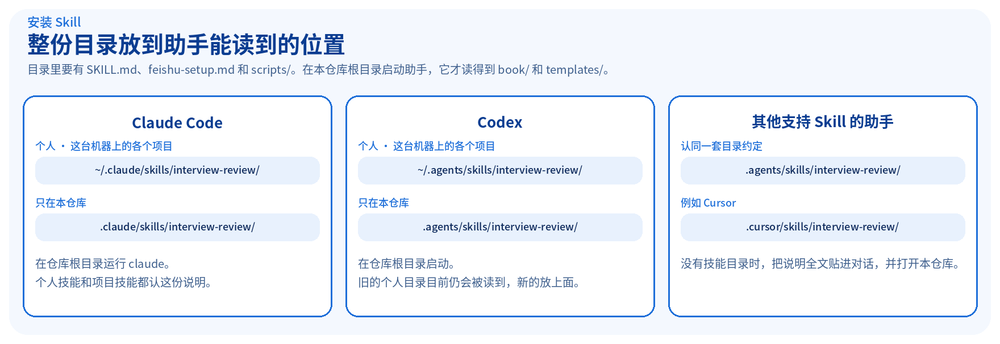

Skill 是一份给助手看的操作说明，目录是 `skills/interview-review/`。里面有 `SKILL.md`、`feishu-setup.md` 和 `scripts/`。复制时带上整份目录。

助手还要能读到 `book/` 和 `templates/`。所以在**本仓库根目录**里启动它。只把 Skill 拷到别处、工作目录却不在这个仓库时，它会找不到模板和打分口径。

下面每条命令都在仓库根目录执行。目标位置已经有同名目录时，先删掉旧的再复制，避免套一层。

**Claude Code。** 只在这个仓库里用：

```bash
mkdir -p .claude/skills
cp -R skills/interview-review .claude/skills/interview-review
```

这台机器上的各个项目都要用，同时仍然从本仓库启动：

```bash
mkdir -p ~/.claude/skills
cp -R skills/interview-review ~/.claude/skills/interview-review
```

然后在本仓库根目录运行 `claude`。个人技能目录是 `~/.claude/skills/<名字>/SKILL.md`，项目技能目录是 `.claude/skills/<名字>/SKILL.md`。

**Codex。** 只在这个仓库里用：

```bash
mkdir -p .agents/skills
cp -R skills/interview-review .agents/skills/interview-review
```

个人、各个项目都要用：

```bash
mkdir -p ~/.agents/skills
cp -R skills/interview-review ~/.agents/skills/interview-review
```

在本仓库根目录启动 Codex。新的个人技能放 `~/.agents/skills/`。旧位置 `~/.codex/skills/` 目前仍会被读到，新安装放前面这一处。

**其他支持 Skill 的助手。** 认同一套目录约定的，放 `.agents/skills/interview-review/`（只此仓库）或 `~/.agents/skills/interview-review/`（个人）。Cursor 可以用项目里的 `.cursor/skills/interview-review/`，或个人目录 `~/.cursor/skills/interview-review/`：

```bash
mkdir -p .cursor/skills
cp -R skills/interview-review .cursor/skills/interview-review
```

助手的文档如果写了别的目录，以它的文档为准。文件夹名保持 `interview-review`，里面要有 `SKILL.md`。

**没有技能目录时。** 在本仓库里开一个对话，把 [`skills/interview-review/SKILL.md`](skills/interview-review/SKILL.md) 全文贴进去，并说明正文在 `book/`、模板在 `templates/`。建飞书结构时，再让它读 [`feishu-setup.md`](skills/interview-review/feishu-setup.md)。

装好后可以直接说「帮我复盘这场面试」，或说「帮我建面试复盘飞书结构」。两种说法走两条不同的流程，下面分开写。

### 你这样说，它交出这些

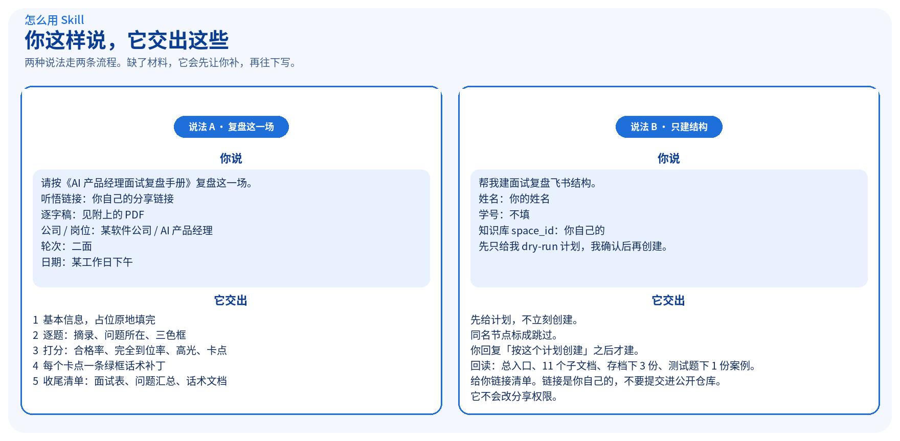

| 你说 | 它走哪条 | 你会拿到 |
| --- | --- | --- |
| 「帮我复盘这场面试」 | 复盘。不建结构 | 基本信息、逐题三色框、打分、每个卡点一条绿框话术补丁、收尾清单 |
| 「帮我建面试复盘飞书结构」「初始化面试记录表」「帮我搭面试复盘知识库」 | 建结构。这场不写复盘 | 先是 dry-run 计划；你确认后才创建，然后是标题和链接清单 |

复盘时把这四样给它：转写分享链接、逐字稿 PDF、公司 / 岗位（可以写成「某软件公司 / AI 产品经理」）、轮次和日期。缺了哪一项，它会先让你补。

可以照下面这段说。完整输出长什么样，见后面的[三色框示例](#三色框)。

```text
请按《AI 产品经理面试复盘手册》复盘这一场。

- 听悟链接：（粘贴你自己的分享链接）
- 逐字稿：见我附上的 PDF
- 公司 / 岗位：某软件公司 / AI 产品经理
- 轮次：二面
- 日期：某工作日下午
```

它按 [`templates/复盘文档模板.md`](templates/复盘文档模板.md) 写出这五块：

1. 基本信息。占位栏填完，逐字稿 PDF 在标题下面。
2. 逐题复盘。每题先写原回答摘录和问题所在，这两栏不加框；然后是三色框。
3. 打分。按环节判完全到位、合格或不合格，给出合格率、完全到位率、高光和卡点。口径在 [第 5 章](book/05-打分口径.md)，空表在 [`templates/打分表.md`](templates/打分表.md)。
4. 话术补丁。每个卡点一条能照念的修正，放进绿框。
5. 收尾清单。面试表只改这一岗的状态，问题汇总只追加问题，话术文档同步口播。

你核对过错字和数字之后，再让它写回这三处，或者自己贴进去。数字以你自己的口径表为准，见 [第 6 章](book/06-话术补丁与数字口径.md)。


## 建飞书结构

第一次使用时，先在**你自己的**飞书知识库里把架子搭好。之后每场面试都往这个架子里放。文档归你本人，助手先给你计划，你确认之后才创建。

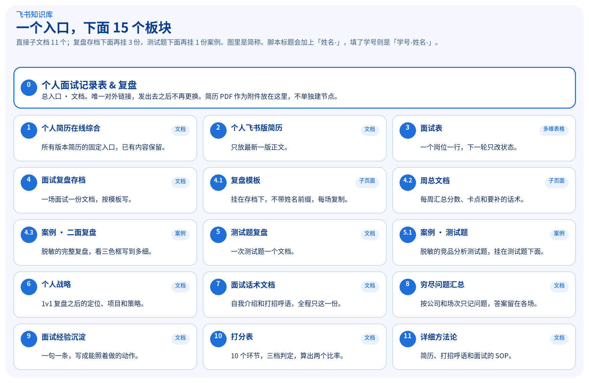

图里是简称。脚本创建的标题带前缀：没填学号是「姓名-」，填了学号是「学号-姓名-」。

| # | 标题 | 类型 |
| --- | --- | --- |
| 0 | 姓名-个人面试记录表&复盘 | 文档，总入口。对外只发这一个链接 |
| 1 | 姓名-个人简历在线综合 | 文档。可以加内容，已有内容保留 |
| 2 | 姓名-个人飞书版简历 | 文档。放最新一版 |
| 3 | 姓名-面试表 | 多维表格。一岗一行 |
| 4 | 姓名-面试复盘存档（一次面试一个文档，按模板） | 文档。一场一份 |
| 4.1 | 复盘模板 | 文档。挂在第 4 个下面，不带姓名前缀 |
| 4.2 | 姓名-周总文档（每周汇总） | 文档。挂在第 4 个下面 |
| 4.3 | （案例）某软件公司（二面）-AI 产品经理 | 文档。脱敏完整复盘案例 |
| 5 | 姓名-测试题复盘（一次测试题一个文档） | 文档 |
| 5.1 | （案例）某大厂AI助手（一面）-竞品分析测试题 | 文档。脱敏测试题案例 |
| 6 | 姓名-个人战略（1v1复盘+面试策略） | 文档 |
| 7 | 姓名-个人面试话术文档（自我介绍+打招呼语） | 文档。全程只这一份 |
| 8 | 姓名-穷尽面试问题汇总（以问题为单位） | 文档。只记问题 |
| 9 | 姓名-面试经验沉淀（以条为单位） | 文档。一句一条 |
| 10 | 姓名-打分表 | 文档。10 环节三档判定 |
| 11 | 姓名-简历+打招呼语+面试 详细方法论 | 文档。自己的 SOP |

每个页面建好后都已经写入说明框、建设攻略和（示例）内容，面试表预置 2 行（示例）记录，详见 [附录 12](book/12-各板块建设攻略与示例.md)。简历 PDF 不单独建节点，作为附件放在总入口里。面试表的字段按 [`templates/面试表Bitable字段定义.json`](templates/面试表Bitable字段定义.json) 配置，一共 10 个，首列是「公司&团队」。手工建表时可以对照 [`templates/面试表字段.md`](templates/面试表字段.md)。

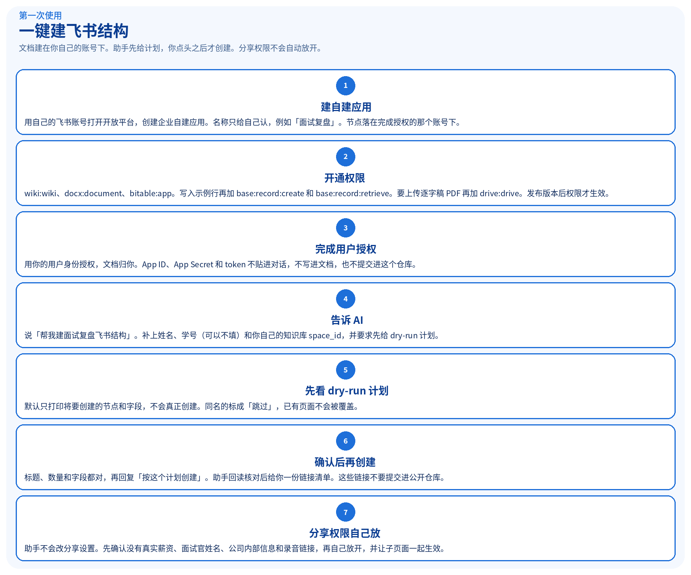

**1. 建自建应用。** 用自己的飞书账号打开 [飞书开放平台](https://open.feishu.cn/app)，创建企业自建应用。名称只给自己认，例如「面试复盘」。用你自己的企业；建出来的知识库节点会落在完成授权的那个账号下。

**2. 开通权限。** 在应用的权限管理里开通：

| 权限 | 用来做什么 |
| --- | --- |
| `wiki:wiki` | 读写知识库节点 |
| `docx:document` | 创建和编辑文档 |
| `bitable:app` | 创建多维表格和字段 |
| `base:record:create`、`base:record:retrieve` | 写入 2 行示例记录、清理默认空行（没开时脚本会提示并跳过） |
| `drive:drive` | 可选。要让助手上传逐字稿 PDF 时再开 |

开通之后发布一个版本，权限才会生效。企业要求管理员审批时，用你有权限的企业，或请管理员通过。

**3. 完成用户授权。** 助手要通过你的用户身份调用接口（`lark-cli`、飞书 MCP，或开放平台接口都可以），授权结果是你自己的 `user_access_token`，这样文档归你。按你所用工具的登录流程，在浏览器里用自己的飞书账号点完授权。App ID、App Secret 和 token 不要贴进对话，不要写进文档，也不要提交进这个仓库。

**4. 对 AI 这样说。**

```text
帮我建面试复盘飞书结构。
姓名：你的姓名
学号：不填
知识库 space_id：（你自己的 space_id）
先只给我 dry-run 计划，我确认后再创建。
```

「初始化面试记录表」和「帮我搭面试复盘知识库」也是同一条流程。听到这些话，助手做的是建结构，不是复盘一场面试。

`space_id` 在知识库的设置里可以看到。已经授权的话，也可以让助手列出你有权限的知识库，把要放进去的那一个 id 告诉它。用你自己的知识库。

**5. 先看 dry-run 计划。** 默认只打印将要创建的节点和字段，不会真正创建。你会看到类似这样的清单（姓名和 space_id 都是你自己的）：

```text
  [计划] 新建 docx     <你的姓名>-个人面试记录表&复盘
  [计划] 新建 docx     <你的姓名>-个人简历在线综合
  [计划] 新建 docx     <你的姓名>-个人飞书版简历
  [计划] 新建 docx     <你的姓名>-简历+打招呼语+面试 详细方法论
  [计划] 新建 bitable  <你的姓名>-面试表
  [计划] 新建 docx     <你的姓名>-面试复盘存档（一次面试一个文档，按模板）
  [计划] 新建 docx     复盘模板
  [计划] 新建 docx     <你的姓名>-周总文档（每周汇总）
  [计划] 新建 docx     （案例）某软件公司（二面）-AI 产品经理
  [计划] 新建 docx     <你的姓名>-打分表
  [计划] 新建 docx     <你的姓名>-测试题复盘（一次测试题一个文档）
  [计划] 新建 docx     （案例）某大厂AI助手（一面）-竞品分析测试题
  [计划] 新建 docx     <你的姓名>-个人战略（1v1复盘+面试策略）
  [计划] 新建 docx     <你的姓名>-个人面试话术文档（自我介绍+打招呼语）
  [计划] 新建 docx     <你的姓名>-穷尽面试问题汇总（以问题为单位）
  [计划] 新建 docx     <你的姓名>-面试经验沉淀（以条为单位）
  [面试表字段] 10 个: 公司&团队、JD&面试记录、base、状态、下一场面试时间、面试方式、投递时间、投递渠道、投递的简历存档链接、父记录
  [面试表] 删除默认列（单选/日期/附件等）与默认空行；写入 2 行（示例）记录
  [计划] 写入内容: 01-个人简历在线综合.xml（2 个高亮框）
  ……（每个页面一行「写入内容」）
  [提醒] 不自动放开权限：检查脱敏后由你本人设为「互联网获得链接的人可阅读/编辑（含子页面）」
```

同名节点会标成「跳过」，已存在的页面不会被覆盖。新建的每个页面都会写进说明框、建设攻略和（示例）内容，测试题复盘和面试复盘存档下各有一份「（案例）」子文档。

**6. 确认后再创建。** 计划里的标题、数量和字段都对，再回复「按这个计划创建」。助手创建后会再读一遍：总入口、11 个子文档、复盘存档下的 3 份和测试题下的 1 份案例都在，页面里有内容和彩色框，面试表字段和 JSON 一致，然后给你一份标题和链接清单。这些链接是你自己的，不要提交进这个公开仓库。

同一套计划可以再跑一次。第二次同名的都会跳过，用来核对有没有漏建。

也可以自己跑脚本，效果和上面相同。脚本默认只打印计划，加上 `--execute` 才创建。前提是本机的 `lark-cli` 已经用你的用户身份授权：

```bash
python3 skills/interview-review/scripts/setup_feishu.py \
  --space-id '<你的 space_id>' \
  --name '你的姓名'

python3 skills/interview-review/scripts/setup_feishu.py \
  --space-id '<你的 space_id>' \
  --name '你的姓名' \
  --execute
```

学号要写进标题时，加上 `--student-id '你的学号'`。

**7. 分享权限自己放。** 助手不会改分享设置。你先检查文档里没有真实薪资、面试官姓名、公司内部信息和录音链接，再自己把总入口设为「互联网获得链接的人可编辑」，并让子页面一起生效。规则见 [第 11 章](book/11-隐私权限与复制.md)。

接口暂时调不通时，按上面的表手工建。已经有一份自己的结构时，用飞书的「创建副本」，勾选「同时创建子页面的副本」，再把标题前缀改成自己的。本仓库不附带任何飞书模板链接。


## 一场面试从投递到复盘

架子搭好之后，一场面试按这八步走。前面三步在投递和准备，后面五步是这场的复盘。不用一次做完手册里的每一章，做完这八步，这一场就闭环了。

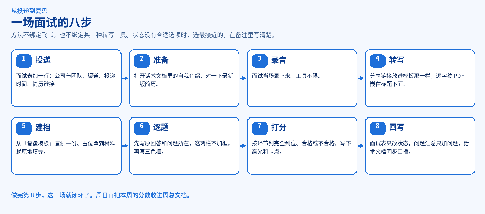


1. **投递。** 面试表加一行，写下公司与团队、投递渠道、投递时间、这份简历的存档链接、当前状态。一个岗位只占这一行。见 [第 2 章](book/02-面试表一岗一行.md)。
2. **准备。** 打开话术文档里的自我介绍和打招呼语，对一下飞书版简历是不是最新一版。话术全程只保持这一份，见 [第 6 章](book/06-话术补丁与数字口径.md)。
3. **录音。** 面试当场录下来。用哪一种录音工具都可以。
4. **转写。** 把分享链接放进复盘模板的那一栏。模板里写的是通义听悟，用别的转写工具也可以，链接放在同一栏。逐字稿 PDF 嵌在「逐字稿」标题正下方。见 [第 3 章](book/03-一场一档与录音转写.md)。
5. **建档。** 从「复盘模板」复制一份，标题写成这场的公司和轮次，例如「某软件公司（二面）」。时间、面试官、录音链接、逐字稿这些占位，拿到材料就原地填完。
6. **逐题。** 每题先写原回答摘录和问题所在，这两栏不加框，然后写绿框口播、红框概念、黄框追问。见 [第 4 章](book/04-逐题复盘与三色框.md)，样子见下面的[三色框](#三色框)。
7. **打分。** 按环节判完全到位、合格或不合格，算出合格率和完全到位率，写下高光和卡点。见 [第 5 章](book/05-打分口径.md)。
8. **回写三处。** 面试表只改这一岗的状态和备注；问题汇总只追加本场新问题，不写答案；话术文档同步绿框口播。三处不要混在一份里改。见 [第 10 章](book/10-防踩坑清单.md)。

二面、三面不新开一行，只改状态和备注。同一家公司的另一个岗位可以新开一行。状态下拉没有合适选项时，选最接近的，在备注里写清楚。


## 每场面试后做复盘

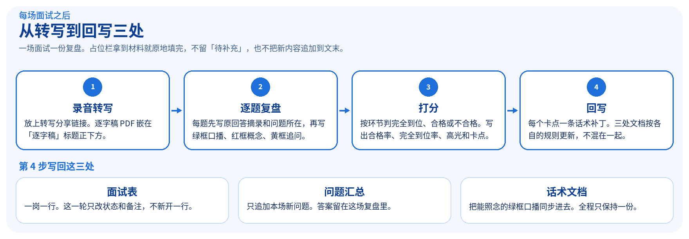

一场面试一份复盘文档，从「复盘模板」复制。时间、面试官、录音链接、逐字稿这些占位，拿到材料就**原地填完**。留着「待补充」，或把新内容追加到文末，别人打开第一屏都看不到完整信息。转写里的人名、术语和数字，对照录音核对后再写进复盘。

交给助手的材料：

- 转写分享链接。模板里的位置写的是通义听悟，用别的转写工具也可以，把链接放在同一栏。
- 逐字稿 PDF。嵌在「逐字稿」标题正下方。嵌错了标题就删掉重嵌，只留一份。
- 公司 / 岗位，可以写成「某软件公司 / AI 产品经理」。
- 轮次和日期。

**对 AI 这样说：**

```text
请按《AI 产品经理面试复盘手册》复盘这一场。

- 听悟链接：（粘贴你自己的分享链接）
- 逐字稿：见我附上的 PDF
- 公司 / 岗位：某软件公司 / AI 产品经理
- 轮次：二面
- 日期：某工作日下午
```

缺了哪一项，助手会先让你补，再往下写。

**AI 会写出这些：**

1. 基本信息。占位栏填完，逐字稿 PDF 在标题下面。
2. 逐题复盘。每题先写原回答摘录和问题所在，这两栏不加框；然后是三色框。
3. 打分。按环节判完全到位、合格或不合格，给出合格率、完全到位率、高光和卡点。口径在 [第 5 章](book/05-打分口径.md)，空表在 [`templates/打分表.md`](templates/打分表.md)。
4. 话术补丁。每个卡点一条能照念的修正，放进绿框。
5. 收尾清单。面试表只改这一岗的状态，问题汇总只追加问题，话术文档同步口播。

你核对过错字和数字之后，再让它写回这三处，或者自己贴进去。


## 每周节奏

一场的闭环是复盘和打分。一周的闭环再加两步：周日把分数收进周总文档，并确认话术补丁已经回到那一份话术文档。顺序是：每场复盘 → 打分表 → 每周总文档 → 话术补丁。

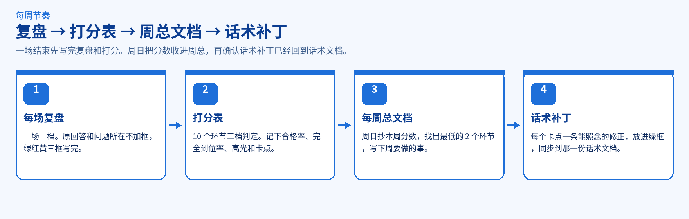

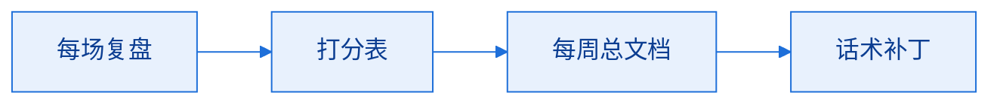

1. **每场复盘。** 一场一档。原回答和问题所在不加框，绿红黄三框写完。模板在 [`templates/复盘文档模板.md`](templates/复盘文档模板.md)。
2. **打分表。** 当场按 10 个环节做三档判定，记下合格率、完全到位率、高光和卡点。空表在 [`templates/打分表.md`](templates/打分表.md)，口径在 [第 5 章](book/05-打分口径.md)。
3. **每周总文档。** 每周日写一份，挂在「面试复盘存档」下面。把本周每场的总分和等级抄进去，找出合格率最低的 2 个环节，写下周要做的事。写法见 [附录 12](book/12-各板块建设攻略与示例.md)，脱敏示例在 [周总文档](examples/各板块示例/03b-周总文档.md)。
4. **话术补丁。** 每个卡点一条能照念的修正，放进绿框，同步进全程只保留的那一份话术文档，并标上日期。见 [第 6 章](book/06-话术补丁与数字口径.md)。项目里的数字保持同一张口径表，不要这场一个版本、下周另一个版本。

经验沉淀可以同一周补 1 到 3 条，一句一条，写进「面试经验沉淀」。那是另一份文档，不替代话术补丁。


## 三色框

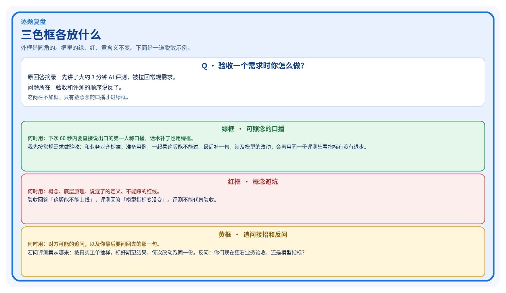

颜色一旦固定，复习时就能直接找到要背的那一句。含义以 [第 4 章](book/04-逐题复盘与三色框.md) 为准：

- 绿框：下次能直接说出口的第一人称口播，60 秒内。话术补丁也用绿框。
- 红框：概念、底层原理、避坑。
- 黄框：对方可能的追问，以及你最后的反问。

什么时候用、什么时候不用：

| 你手里的内容 | 放哪 |
| --- | --- |
| 下次要照着念的第一人称口播，60 秒内 | 绿框 |
| 这场卡点的修正句，能直接念 | 绿框，作为话术补丁 |
| 概念、底层原理、说混了的定义、不能踩的红线 | 红框 |
| 对方可能的追问，以及你要问回去的那一句 | 黄框 |
| 原回答摘录、问题所在、你对这场的点评 | 不加框 |

飞书里用高亮块：绿 `light-green` / `green`，红 `light-red` / `red`，黄 `light-yellow` / `yellow`。文档工具没有高亮块时，用 🟢 / 🔴 / 🟡 引用块，含义不变。

下面这段是脱敏示例，用来看格式。数字和说法与 [examples/示例-某软件公司二面复盘.md](examples/示例-某软件公司二面复盘.md) 一致。

```markdown
# 某软件公司（二面）复盘

## Q1 验收一个需求时你怎么做？（约开场后段）
- 原回答摘录：先讲了大约 3 分钟 AI 评测，被拉回常规需求。
- 问题所在：验收和评测的顺序说反了。

🟢 建议回答：我先按常规需求做验收：和业务对齐标准，准备用例，一起看这版能不能过。最后补一句，涉及模型的改动，会再用同一份评测集看指标有没有退步。

🔴 概念避坑：验收回答「这版能不能上线」，评测回答「模型指标变没变」。评测不能代替验收。

🟡 追问接招：若问评测集从哪来，就说按真实工单抽样，标好期望结果，每次改动跑同一份。反问：你们现在更看业务验收，还是模型指标？

## 打分
75/100，B。12 个环节里 10 个合格、4 个完全到位。合格率 83%，完全到位率 33%。
高光：用一个具体流程讲清「怎么快速熟悉一个系统」。
卡点：把「漏跟进率 12%→4%」说成了「降到 40%」。这个数字以口径表为准。

## 收尾检查
- [ ] 面试表：这一岗只改状态，备注写「二面完成，待通知」
- [ ] 问题汇总：只追加本场新问题，不写答案
- [ ] 话术文档：把绿框口播同步进去
```


## 没有飞书时

方法不绑定飞书，也不绑定某一种转写工具。见 [第 11 章](book/11-隐私权限与复制.md)。

1. 把 [`templates/`](templates/) 里的复盘模板、打分表、面试表字段抄到你正在用的文档和表格里。
2. 做一份总入口。下面挂面试表、每场复盘、问题汇总、话术、测试题和个人战略。入口链接定下来之后就不再换，规则见 [第 1 章](book/01-总入口与目录结构.md)。
3. 表格里一个岗位一行。二面、三面只改状态和备注。状态下拉里没有合适选项时，选最接近的，在备注里写清楚。见 [第 2 章](book/02-面试表一岗一行.md)。
4. 每场面试复制 [`templates/复盘文档模板.md`](templates/复盘文档模板.md)。任意转写工具的分享链接和逐字稿 PDF，填进对应占位，PDF 嵌在标题下面。
5. 逐题按三色框写，打分用 [`templates/打分表.md`](templates/打分表.md)。
6. 做完勾三处：面试表状态、问题汇总、话术文档。

没有助手也可以照着做。有助手但没有飞书接口时，把逐字稿贴给它，让它按模板在对话里写出复盘，你再复制到自己的文档。


## 常见问题


脚本报错的对照表在 <a href="skills/interview-review/feishu-app-setup.md#三常见报错对照">常见报错对照</a>。


- 想零配置拿到结构：用「快速开始 · 路线 ①」复制公开案例。脚本报错先查 [常见报错对照](skills/interview-review/feishu-app-setup.md#三常见报错对照)。

**要十一章都做完吗？** 不用。挑一两条先用起来就算数。三色框、一岗一行、一场一档，单独做哪一条都成立。

**必须用飞书和听悟吗？** 不用。飞书是一键建结构时的默认落点，听悟是模板里录音链接那一栏的例子。任意文档工具加任意转写工具，步骤相同。

**二面要新开一行吗？** 不新开。一个岗位一行，下一轮只改状态和备注。同一家公司的另一个岗位可以新开一行。见 [第 2 章](book/02-面试表一岗一行.md)。

**状态下拉没有「二面已完成」怎么办？** 选最接近的一项，在备注里写清楚。不要为了这个新开一行，也不要临时加一个选项。

**助手会把文档公开吗？** 不会。脚本和 Skill 都不调用权限接口。分享要你自己开，打开之前先脱敏。见 [第 11 章](book/11-隐私权限与复制.md)。

**建结构跑两次，会不会出两套文档？** 同名的会跳过。第二次应全部显示跳过。总入口已有正文时，助手会先问要不要覆盖。

**占位可以先留着「待补充」吗？** 材料已经在手上，就原地填完。第一屏应是完整信息。见 [第 3 章](book/03-一场一档与录音转写.md)。

**绿框里可以写点评吗？** 绿框只放能照念的口播。概念和红线放红框，追问和反问放黄框。原回答、问题所在不加框。

**分享样例时公司怎么写？** 写成「某软件公司」「某大厂」这类说法。仓库里的 [样例](examples/示例-某软件公司二面复盘.md) 已经按这个处理过。真实姓名、薪资、内部信息和链接不要出现在对外版本里。

**Skill 说找不到模板或打分口径？** 在本仓库根目录启动助手，让它能读到 `book/` 和 `templates/`。只贴了 `SKILL.md` 时，把 [`templates/复盘文档模板.md`](templates/复盘文档模板.md) 和 [第 5 章](book/05-打分口径.md) 一并给它。

**学号必填吗？** 不填。填了之后，节点标题的前缀变成「学号-姓名」。

**简历 PDF 要单独建一个子文档吗？** 不建。放到总入口里，作为附件。


## 目录

1. [总入口与目录结构](book/01-总入口与目录结构.md)：所有资料挂在一份总文档下，这个链接发出去之后就不再更换。
2. [面试表一岗一行](book/02-面试表一岗一行.md)：一个岗位只占一行，下一轮只改状态和备注。
3. [一场一档与录音转写](book/03-一场一档与录音转写.md)：每场面试一份复盘，录音放分享链接，逐字稿 PDF 嵌在标题下面，占位原地填。
4. [逐题复盘与三色框](book/04-逐题复盘与三色框.md)：每题先写原回答和问题所在，再用绿框口播、红框概念、黄框追问。
5. [打分口径](book/05-打分口径.md)：按环节判完全到位、合格或不合格，算出合格率和完全到位率，并写下高光和卡点。
6. [话术补丁与数字口径](book/06-话术补丁与数字口径.md)：每个卡点写一条能照念的修正，项目数字保持同一张口径表。
7. [问题穷尽汇总](book/07-问题穷尽汇总.md)：按公司类型和场次只记问题，答案留在各场复盘里。
8. [经验心法与测试题](book/08-经验心法与测试题.md)：心法一条一句；测试题放已经标好答案的版本，并写上自己原来的差距。
9. [来自前辈交流的面试心法](book/09-来自前辈交流的面试心法.md)：让大模型扮演行业总监，先喂同行材料和回答，再请它点评你的回答。
10. [防踩坑清单](book/10-防踩坑清单.md)：脚本不要重复插入，PDF 不要嵌错位置，做完要回写面试表、问题汇总和话术。
11. [隐私权限与复制](book/11-隐私权限与复制.md)：复制时带上子页面；放开链接之前先脱敏。没有飞书也能用同一套方法。
12. [各板块建设攻略与示例（附录）](book/12-各板块建设攻略与示例.md)：每个页面的说明框、一步步怎么建、脱敏参考示例；建结构脚本会把它们直接写进飞书，新页面不是空白。

正文就在这 11 个文件里，外加附录第 12 章。模板和样例不在正文里重复一遍：

- [复盘文档模板](templates/复盘文档模板.md)
- [打分表](templates/打分表.md)
- [面试表字段](templates/面试表字段.md)
- [面试表字段定义（给脚本用）](templates/面试表Bitable字段定义.json)
- [脱敏样例：某软件公司二面](examples/示例-某软件公司二面复盘.md)
- [各板块脱敏示例（每个页面一份）](examples/各板块示例/)
- [飞书页面内容源文件（脚本写入用的 XML）](templates/feishu/)


## 许可

本仓库以 [CC BY 4.0](LICENSE) 发布。你可以转载、改编、商用，同时做三件事：

- 署名：「AI 产品经理面试复盘手册」，并附上仓库链接 https://github.com/CageEcho/howtointerviewbetter
- 附上许可证链接 https://creativecommons.org/licenses/by/4.0/
- 改过的，写明改了什么。

`skills/interview-review/scripts/setup_feishu.py` 随仓库一起提供，用来在你自己的知识库里建结构。它默认只打印计划，不会改分享权限。


## 赞赏

如果这套复盘方法帮你拿到了面试或 offer，欢迎扫码请我喝杯咖啡，所有内容永久免费。

<p>
</p>

## 商务合作

📮 zsysabre@163.com


