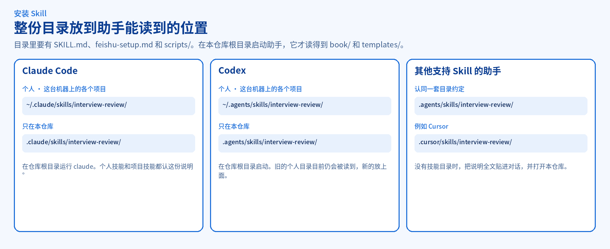
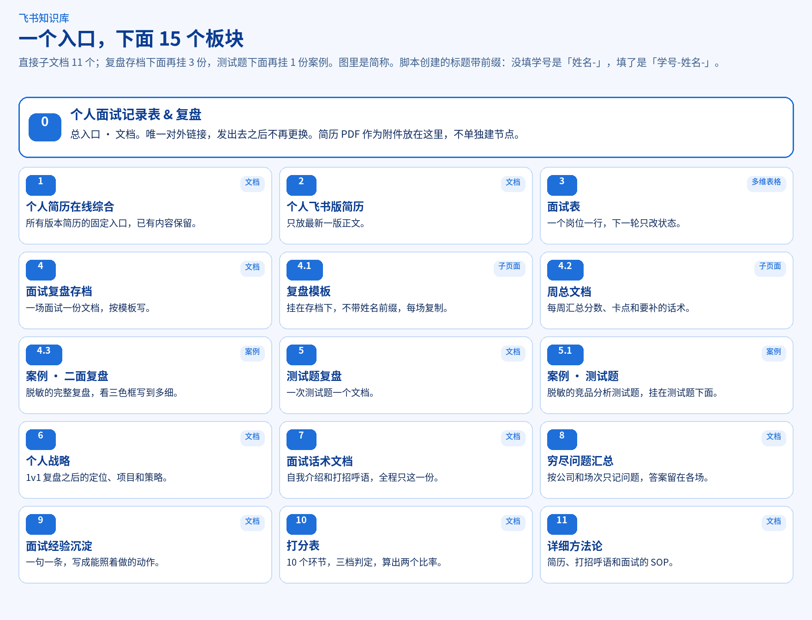
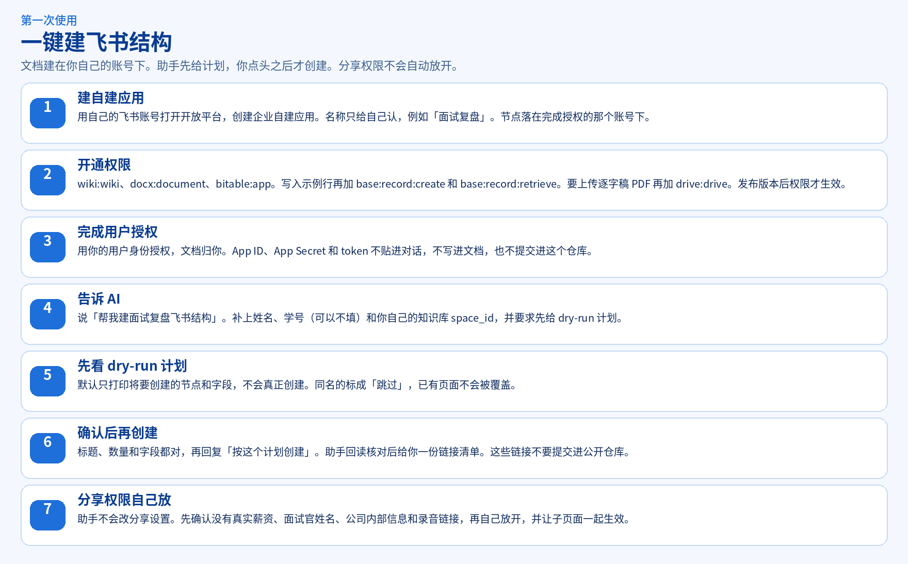
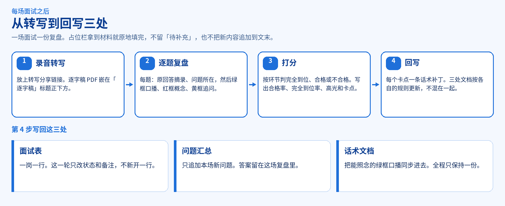
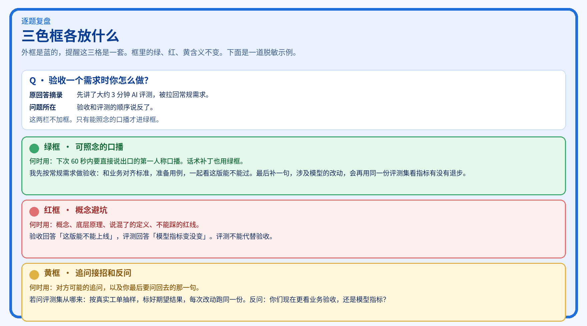

<div align="center">


# interview-review

让 AI 按《AI 产品经理面试复盘手册》做复盘。给它转写链接和逐字稿，它按书里的模板写完，并列出要回写的三处。

[回到手册首页](../../README.md)

</div>

---

说「帮我复盘这场面试」，走复盘。说「帮我建面试复盘飞书结构」「初始化面试记录表」或「帮我搭面试复盘知识库」，走建结构，这场不写复盘。

手册正文在 [`book/`](../../book/)，模板在 [`templates/`](../../templates/)。操作说明是本目录的 [`SKILL.md`](SKILL.md)，建飞书结构的步骤在 [`feishu-setup.md`](feishu-setup.md)。

## 安装



复制**整份** `skills/interview-review/` 目录，里面要有 `SKILL.md`、`feishu-setup.md` 和 `scripts/`。下面的命令在**手册仓库根目录**执行。目标位置已有同名目录时，先删掉旧的再复制。

助手要能读到仓库里的 `book/` 和 `templates/`，所以在这个根目录里启动它。

**Claude Code**

只在这个仓库里用：

```bash
mkdir -p .claude/skills
cp -R skills/interview-review .claude/skills/interview-review
```

这台机器上的各个项目都要用（使用时仍从这个仓库启动）：

```bash
mkdir -p ~/.claude/skills
cp -R skills/interview-review ~/.claude/skills/interview-review
```

然后在仓库根目录运行 `claude`。

**Codex**

```bash
mkdir -p .agents/skills
cp -R skills/interview-review .agents/skills/interview-review
```

个人目录：

```bash
mkdir -p ~/.agents/skills
cp -R skills/interview-review ~/.agents/skills/interview-review
```

在仓库根目录启动 Codex。旧位置 `~/.codex/skills/` 目前仍会被读到；新的放 `~/.agents/skills/`。

**其他支持 Skill 的助手**

认同一套目录的，放 `.agents/skills/interview-review/` 或 `~/.agents/skills/interview-review/`。Cursor 可以用：

```bash
mkdir -p .cursor/skills
cp -R skills/interview-review .cursor/skills/interview-review
```

个人技能放 `~/.cursor/skills/interview-review/`。助手的文档如果写了别的目录，以它的文档为准，文件夹名保持 `interview-review`。

没有技能目录时：打开本仓库，把 [`SKILL.md`](SKILL.md) 全文贴进对话。建结构时再让它读 [`feishu-setup.md`](feishu-setup.md)。

## 第一次：建飞书结构





文档建在你自己的飞书账号下。详细权限和节点全称见 [手册首页的「建飞书结构」](../../README.md#建飞书结构)，步骤原文在 [`feishu-setup.md`](feishu-setup.md)。

1. 用自己的账号在 [飞书开放平台](https://open.feishu.cn/app) 创建企业自建应用。
2. 开通 `wiki:wiki`、`docx:document`、`bitable:app`。要上传逐字稿 PDF 再加 `drive:drive`。发布版本后权限才生效。
3. 用你的用户身份完成授权。App ID、Secret 和 token 不要贴进对话或写进仓库。
4. 对 AI 这样说：

```text
帮我建面试复盘飞书结构。
姓名：你的姓名
学号：不填
知识库 space_id：（你自己的 space_id）
先只给我 dry-run 计划，我确认后再创建。
```

5. 核对计划：总入口、11 个子文档、复盘存档下的 3 份、测试题下的 1 份案例，以及面试表 10 个字段。同名的会标成跳过。
6. 回复「按这个计划创建」。助手回读核对后，给你一份链接清单。链接是你自己的，不要提交进这个公开仓库。
7. 助手不会改分享权限。你先确认没有真实薪资、面试官姓名、公司内部信息和录音链接，再自己设为「获得链接的人可编辑」，并对子页面生效。

也可以自己跑脚本。默认只打印计划，`--execute` 才创建。需要已经用你的用户身份授权的 `lark-cli`：

```bash
python3 skills/interview-review/scripts/setup_feishu.py \
  --space-id '<你的 space_id>' \
  --name '你的姓名'

python3 skills/interview-review/scripts/setup_feishu.py \
  --space-id '<你的 space_id>' \
  --name '你的姓名' \
  --execute
```

学号要写进标题时加 `--student-id '你的学号'`。字段定义在 [`templates/面试表Bitable字段定义.json`](../../templates/面试表Bitable字段定义.json)。

## 每场面试之后



准备四样：转写分享链接（模板栏写的是通义听悟，其他工具也可以）、逐字稿 PDF、公司/岗位（可写成「某软件公司 / AI 产品经理」）、轮次和日期。

**对 AI 这样说：**

```text
请按《AI 产品经理面试复盘手册》复盘这一场。

- 听悟链接：（粘贴你自己的分享链接）
- 逐字稿：见我附上的 PDF
- 公司 / 岗位：某软件公司 / AI 产品经理
- 轮次：二面
- 日期：某工作日下午
```

缺了材料，它会先让你补。然后按 [`templates/复盘文档模板.md`](../../templates/复盘文档模板.md) 写出：

- 基本信息。占位原地填完，PDF 嵌在「逐字稿」标题下面。
- 逐题：原回答摘录、问题所在（这两栏不加框），然后三色框。
- 打分：合格率、完全到位率、高光、卡点。口径见 [`book/05-打分口径.md`](../../book/05-打分口径.md)。
- 每个卡点一条绿框话术补丁。
- 收尾：面试表只改状态，问题汇总只记问题，话术文档同步口播。



飞书高亮块的颜色：绿 `light-green` / `green`，红 `light-red` / `red`，黄 `light-yellow` / `yellow`。没有高亮块时用 🟢 / 🔴 / 🟡 引用块。

脱敏后的一整场样例见 [`examples/示例-某软件公司二面复盘.md`](../../examples/示例-某软件公司二面复盘.md)。格式长什么样，手册首页的[输出示例](../../README.md#三色框)里有一段。

你核对过错字和数字口径之后，再让它写回三处，或自己贴进文档。

## 没有飞书时

把模板抄到任意文档和表格里：总入口一份，面试表一岗一行，每场复制复盘模板。把逐字稿交给助手，让它在对话里按模板写完，你再复制过去。步骤见 [手册首页「没有飞书时」](../../README.md#没有飞书时)。

## 它会读哪些文件

| 文件 | 用来做什么 |
| --- | --- |
| [`SKILL.md`](SKILL.md) | 复盘步骤和约束 |
| [`feishu-setup.md`](feishu-setup.md) | 建飞书结构的节点、权限和幂等规则 |
| [`scripts/setup_feishu.py`](scripts/setup_feishu.py) | 默认同名跳过的创建脚本，默认只打印计划；建好的每页都带说明框、攻略和示例 |
| [`../../templates/feishu/`](../../templates/feishu/) | 脚本写进每个飞书页面的内容（飞书 XML） |
| [`templates/复盘文档模板.md`](../../templates/复盘文档模板.md) | 每场复盘的版式 |
| [`templates/面试表Bitable字段定义.json`](../../templates/面试表Bitable字段定义.json) | 面试表字段 |
| [`book/05-打分口径.md`](../../book/05-打分口径.md) | 打分 |
| [`book/`](../../book/) | 其余章节，助手只按这些章节作答 |
